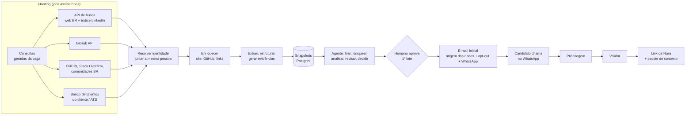

# Arquitetura técnica: hunting, coleta de dados e etapas do agente

**Data:** 2026-11-07 (revisão 2). **Estado:** proposta, aguardando aprovação do time.
**Complementa:** `2026-11-07-agente-recrutador-design.md`, seções 5, 7, 9, 11 e 12.

"Decidido" vem do usuário ou do time. O resto é decisão de design e pode ser corrigido.

O documento responde a quatro perguntas:

1. Como encontrar candidatos automaticamente no Brasil, com contexto rico, sem depender do candidato preencher nada?
2. Como trazer o LinkedIn para dentro da solução sem fazer scraping?
3. Como dividir cada etapa do agente, do hunting à entrevista com a Nara?
4. Como manter o sistema estável, escalável e seguro em qualquer dia?

## 1. Decisões que orientam a arquitetura

- **Hunting automático é o núcleo (decidido).** O agente encontra a pessoa, o GitHub e o site sozinho. Se o candidato tivesse que preencher dados, o produto não seria diferente de uma Gupy.
- **Escopo Brasil, com bases brasileiras (decidido).**
- **Base legal: legítimo interesse (decidido)**, com teste de balanceamento documentado e transparência no primeiro contato.
- **Primeiro contato por e-mail, com um número de WhatsApp (decidido).** A conversa no WhatsApp só começa quando o candidato chama. Nela, o agente faz a pré-triagem e, depois da validação, envia o link para reservar a entrevista com a Nara.
- **O LinkedIn precisa entrar na coleta (decidido)**, com uma solução estruturada. A seção 4 propõe a solução.

**Princípio técnico:** o agente não busca dados na web enquanto decide. Jobs de hunting coletam, normalizam e gravam versões dos perfis (snapshots), com a fonte de cada informação. A decisão lê só do banco. Uma fonte fora do ar deixa a base menos completa, mas não quebra a execução da vaga.

## 2. Visão geral



## 3. Fontes brasileiras para hunting

| Fonte | O que traz | Como acessa | Contato publicado? | Estabilidade |
|---|---|---|---|---|
| **API de busca** (ex.: Brave Search, filtro país BR) | Páginas da pessoa: portfólio, palestras, artigos, e o índice de perfis do LinkedIn (seção 4) | API paga e oficial | Às vezes, no site encontrado | Alta: API versionada |
| **GitHub** | Linguagens, projetos, contribuições, cidade, site, redes sociais | API oficial: busca por `location` (cidades e estados BR normalizados) e linguagem | Campo de e-mail público do perfil | Alta |
| **Sites e blogs pessoais** | Histórico, projetos, palestras, contato | Coleta educada de URLs encontradas nas outras fontes | Página de contato | Baixa: HTML livre, sempre opcional |
| **ORCID** | Pesquisadores com vínculo no Brasil | API pública | Se a pessoa deixou público | Alta |
| **Lattes (CNPq)** | Currículo acadêmico brasileiro | Por links encontrados na busca ou em convênio institucional. Sem robô contra o captcha | Raramente | Média |
| **Stack Overflow, GitLab, npm/PyPI, Kaggle** | Evidência técnica pública | APIs oficiais | Raramente | Alta |
| **Comunidades e eventos BR** (palestrantes de Python Brasil, TDC, meetups) | Pessoas ativas na área | Páginas públicas de programação dos eventos | Às vezes | Média |
| **Banco de talentos do cliente** (decidido: um por empresa) | Ex-candidatos e indicações | Importação ou API do ATS do cliente | Sim | Alta |
| **Gupy** | Candidatos e vagas do cliente | API pública, com token da empresa cliente | Sim | Alta |
| **Catho, InfoJobs (busca de currículos)** | Bases grandes de currículos | Licença do cliente. Não achamos uma API pública de currículos; seria parceria comercial | Sim | Futuro |

**Normalização brasileira:** cidades e estados com variações ("Recife", "Recife - PE", "PE, Brasil"), cargos normalizados pela CBO e sinônimos em português e inglês ("dev backend", "engenheiro de software").

**Currículos encontrados na web:** só os publicados pela própria pessoa, no site dela ou num perfil dela (ex.: `meusite.dev/curriculo.pdf`). Currículos em portais de vagas, pastas abertas ou sites de terceiros ficam de fora, porque não foram tornados públicos pelo titular. Na ingestão, o coletor apaga CPF, RG, endereço, data de nascimento, foto e telefone, e guarda só os dados profissionais.

**Telefone:** não coletamos. O WhatsApp só começa quando o candidato chama (decidido), então o telefone chega por ele.

**Contato:** usamos só um e-mail que a própria pessoa publicou para contato (perfil do GitHub, página de contato do site, ORCID). Não deduzimos e-mails (`nome@empresa.com`), não tiramos e-mails de commits e não compramos listas. Se não há contato publicado, o candidato fica como "sem canal". O recrutador decide se aborda a pessoa manualmente pelo LinkedIn dele (seção 4, camada 3).

## 4. Solução para o LinkedIn

### O que não fazemos, e por quê

| Caminho | Por que fica de fora |
|---|---|
| Robô que abre `linkedin.com` (com ou sem login) | Os termos do LinkedIn proíbem coleta automatizada. Em 2025, o LinkedIn processou o Proxycurl, que encerrou as atividades em julho |
| Contas falsas, automação de navegador, extensão na conta do recrutador | Mesma proibição, e ainda bloqueia a conta do recrutador |
| Serviços que operam a conta do recrutador num navegador na nuvem (ex.: Linked API) | É automação da conta, que os termos proíbem. O próprio serviço diz que não é autorizado pelo LinkedIn e que não garante contra restrição da conta. Cada cliente arriscaria a conta do recrutador, e o produto dependeria de um fornecedor que pode cair como o Proxycurl |
| Fornecedores que revendem dados raspados do LinkedIn | O risco jurídico passa para nós, e o fornecedor pode sumir |
| VPN para usar a API de portabilidade da UE | A API checa a localização no perfil do membro, não o IP de quem consulta. Ela só entrega os dados de quem autorizou e não tem busca. Usar VPN para isso é burlar os termos |
| API de busca do Google | A Custom Search JSON API não aceita clientes novos e será desligada em 1º/1/2027 |
| Raspar a página de resultados do Google, direto ou por APIs de terceiros que fazem isso | Os termos do Google proíbem, o Google bloqueia com captcha e o formato muda sem aviso. É a instabilidade que queremos evitar |

### O que fazemos: cinco camadas

**Camada 1: índice do LinkedIn por API de busca (descoberta).**
- Buscadores indexam perfis públicos do LinkedIn. A partir dos critérios da vaga, o agente gera consultas para uma API de busca oficial. Exemplo: `site:linkedin.com/in "Recife" "desenvolvedor" "Python"`.
- O resultado vem **do buscador**: URL do perfil, título (normalmente nome, cargo e empresa) e trecho com a cidade. Gravamos isso como `FonteBruta` do tipo `busca`, com origem no buscador.
- **O sistema nunca abre a URL do LinkedIn.** O coletor bloqueia `linkedin.com` e subdomínios em código, sem exceção.
- **O que costuma vir no resultado** (varia por buscador e por pessoa; testar com os perfis do próprio time): nome, título profissional, empresa atual, formação mais recente, cidade e, às vezes, o começo do "Sobre".
- **O que não vem:** histórico completo com datas, lista de competências, currículo, site pessoal e contatos. Quem esconde o perfil dos buscadores nas configurações do LinkedIn não aparece.
- **Como completar:** com nome, empresa e cidade, o agente faz uma segunda busca pelas outras páginas da pessoa (GitHub, site, palestras) e só junta os registros quando há um link cruzado (camada 2), para não confundir homônimos.
- Esses dados entram com confiança "autodeclarada, possivelmente desatualizada". Servem para descobrir a pessoa e cruzar identidades, nunca como única evidência de uma competência.
- O plano da API precisa permitir armazenar os resultados. No Brave Search, isso exige um plano "com direito de armazenamento".
- **Risco:** é uma zona cinzenta. Não acessamos o LinkedIn, mas o LinkedIn pode contestar o uso. Precisa de validação jurídica antes de ir para produção.

**Camada 2: o LinkedIn como chave de identidade (cruzamento).**
- Muita gente coloca o link do LinkedIn no GitHub (a API do GitHub devolve as redes sociais do perfil) ou no próprio site. Quando a URL da camada 1 aparece também no GitHub ou no site, temos alta confiança de que é a mesma pessoa.
- Assim, o LinkedIn diz **quem é e onde trabalha**, e o GitHub e o site dizem **o que a pessoa faz**, com evidência verificável.

**Camada 3: o recrutador no LinkedIn, como ação humana.**
- Candidatos bons sem contato publicado aparecem numa lista "abordar pelo LinkedIn". O painel prepara a mensagem, e o recrutador envia pela própria conta. O sistema não automatiza nada dentro do LinkedIn.

**Camada 4: integração oficial por um ATS parceiro.**
- A Gupy divulga integração com o LinkedIn Recruiter. Clientes com Recruiter levam perfis para a Gupy, e nós lemos pela API pública da Gupy com o token do cliente. Precisa confirmar quais campos chegam.
- No futuro, uma parceria direta com o LinkedIn Talent Solutions.

**Camada 5: o candidato aprofunda, depois do interesse.**
- Na pré-triagem do WhatsApp, o agente pode pedir o PDF do perfil do LinkedIn ou o currículo para completar o pacote da Nara. É opcional e acontece depois do contato, não antes, então não volta a ser a lógica da Gupy.

## 5. Base legal e transparência (LGPD)

Validar tudo com alguém da área jurídica antes de produção.

- **Legítimo interesse (art. 7º, IX, e art. 10).** Dados profissionais tornados públicos pela pessoa (art. 7º, §4º), usados para oferecer uma vaga compatível com esse perfil. O art. 10 pede que o legítimo interesse use só os dados necessários e tenha transparência. A ANPD pode pedir um relatório de impacto (RIPD).
- **Teste de balanceamento (LIA):** documento do produto que registra finalidade, necessidade, expectativa razoável do titular e salvaguardas. Pode partir do guia de legítimo interesse da ANPD.
- **Minimização:** só dados profissionais. O coletor descarta foto, data de nascimento, endereço, estado civil e qualquer dado sensível antes de gravar.
- **Transparência no primeiro e-mail:** quem somos, para qual empresa e vaga, **de onde veio o contato** (ex.: "seu perfil público no GitHub"), o que guardamos e um link para excluir os dados ou não receber mais contato.
- **Lista de supressão:** quem pede para sair vira um hash de e-mail e de identidades em uma lista consultada antes de cada coleta e contato. Os demais dados são apagados. O hash existe só para respeitar o pedido.
- **Direitos (art. 18) e revisão de decisão automatizada (art. 20):** o mesmo link permite acesso, correção e exclusão. O agente só descarta sozinho por requisito objetivo, com registro, e a contratação é sempre humana.
- **Prazo de retenção:** perfis não contatados ou sem resposta expiram (ex.: 90 dias), salvo se a pessoa aceitar entrar no banco de talentos.

## 6. Pipeline de coleta

| Etapa | O que faz | IA ou código | Se falhar |
|---|---|---|---|
| **Planejar consultas** | Converte os critérios da vaga em consultas por fonte, com sinônimos e cidades | LLM propõe, código valida e limita a quantidade | Usa consultas-modelo por cargo |
| **Descobrir** | Roda as consultas, pagina e grava os resultados brutos com origem | Código | Fonte fora: segue com as outras e registra a cobertura |
| **Resolver identidade** | Junta registros da mesma pessoa por links cruzados (LinkedIn ↔ GitHub ↔ site), e-mail e usuário. Nome e cidade parecidos só sugerem a junção | Código | Na dúvida, mantém separado |
| **Enriquecer** | Segue os links da pessoa: perfil e repositórios do GitHub, site, ORCID | Código | Perfil fica marcado "sem site" ou "sem GitHub", sem perder pontos |
| **Extrair texto** | HTML para texto principal, README, PDFs encontrados | Código, em subprocesso com limites | Fonte marcada como ilegível |
| **Estruturar** | Monta `PerfilEstruturado` (experiências, competências, links), validado pelo Pydantic | LLM barato | Corrige uma vez; depois, revisão humana |
| **Verificar** | Datas, tempo de experiência **calculado em código**, sobreposições | Código | Gera alertas, nunca descarta |
| **Gerar evidências** | Cada afirmação ganha trecho literal e localização na fonte | LLM + código | Afirmação sem trecho é descartada |
| **Gravar snapshot** | Versão do perfil com `versao_esquema` e hashes das fontes | Código, em transação | Nada fica pela metade |

**Atualidade:** cada snapshot tem validade (ex.: 30 dias). Antes do e-mail, o agente confere se o perfil está atual e se a pessoa não entrou na lista de supressão.

### Regras do coletor web

- **Bloqueio fixo em código:** `linkedin.com` e subdomínios, e qualquer página atrás de login.
- Respeita o `robots.txt`, faz 1 requisição por segundo por domínio, usa user-agent identificado e visita no máximo 5 páginas por domínio.
- Limite de 2 MB, 10 segundos, até 3 redirecionamentos, só `text/html` e `application/pdf`.
- Proteção contra SSRF: bloqueia IPs privados, de loopback, link-local e de metadados de nuvem, e revalida a cada redirecionamento.
- Sem JavaScript no hackathon. Em produção, navegador headless só em contêiner isolado.

## 7. Modelo de dados canônico

Entra em `backend/contratos`.

```text
Candidato        id, tenant_id, vínculos de identidade (hashes), base_legal, estado_contato, suprimido
FonteBruta       id, candidato_id, tipo (busca|api|web|ats|candidato|sintetico), origem, url,
                 hash, coletado_em, real|simulado
PerfilSnapshot   id, candidato_id, versao, versao_esquema, criado_em, valido_ate, fontes[]
  experiencias[] empresa, cargo, cargo_cbo, inicio, fim, descricao, evidencias[]
  competencias[] nome, nível declarado, evidencias[]
  contatos[]     canal, valor (cifrado), fonte_id, publicado_para_contato: bool
Evidencia        id, fonte_id, trecho (literal), localizador (URL#, linha, página), confianca
                 confianca: autodeclarada | verificavel | verificada
VisaoCega        PerfilSnapshot sem nome, foto, gênero, idade, endereço, contatos
Contato          id, candidato_id, vaga_id, canal (email|whatsapp), chave_idempotente,
                 estado, mensagens[], opt_out_em
PreTriagem       contato_id, perguntas[], respostas[], resultado, revisado_por
```

**Confiança:** um cargo vindo do índice do LinkedIn é "autodeclarado". Um repositório Python ativo é "verificável". Uma resposta confirmada na pré-triagem ou por um humano é "verificada". A explicação para a Nara mostra essa diferença.

**Visão cega:** triagem, ranking e análise recebem só a `VisaoCega`. Nome e contato aparecem apenas nas etapas de contato e entrega. O teste de viés fica garantido pela arquitetura.

## 8. Etapas do agente

O agente é uma máquina de estados em código. Cada etapa grava o estado e a decisão antes de seguir.

| # | Etapa | Saída | IA ou código | Modelo | Se falhar |
|---|---|---|---|---|---|
| 1 | **Configurar** | `CriteriosVaga` versionados: eliminatórios, competências, pesos, cidade/remoto, meta | LLM propõe, humano aprova | GLM-5.2 | Vaga ambígua: pergunta |
| 2 | **Hunting** | Snapshots novos ou atualizados (seção 6) | Jobs assíncronos | Barato | Cobertura parcial registrada |
| 3 | **Triar** | Aprovados e descartados, com a regra aplicada | **Só código** | Nenhum | Não aplicável |
| 4 | **Ranquear** | Os K melhores para análise | Código: pontuação lexical ou por embedding | Nenhum ou embedding local | Só lexical |
| 5 | **Analisar** | Nota por critério, evidências citadas e lacunas | LLM em paralelo, saída validada | GLM-5.2 | Repete, troca de modelo ou revisão humana |
| 6 | **Revisar** | Objeções e afirmações removidas | Checagem literal em código + LLM independente | GLM-5.2 | Sem revisor: não segue sozinho |
| 7 | **Decidir** | Descartar, indicar ou pedir decisão humana | **Só código** | Nenhum | Não aplicável |
| 8 | **Aprovar contato** | Lote aprovado pelo recrutador (o primeiro lote da vaga é sempre aprovado por humano) | Humano | Nenhum | Lote espera |
| 9 | **E-mail inicial** | E-mail enviado, com origem dos dados, opt-out e link do WhatsApp | LLM redige, código monta, checa supressão e limites e envia | GLM-5.2 | Repete com chave idempotente; nunca envia duas vezes |
| 10 | **Pré-triagem no WhatsApp** | Respostas estruturadas e dúvidas resolvidas | LLM conversa e extrai; código conduz o roteiro e os limites | Barato para classificar, GLM-5.2 para conversar | Fora do roteiro ou dúvida jurídica: passa para humano |
| 11 | **Validar e entregar** | Link da Nara para reservar a entrevista + `PacoteNara` | Código decide; humano nos casos ambíguos | Barato para resumir | Repete com chave idempotente |
| 12 | **Aprender** | Proposta de ajuste nas consultas e nos pesos, com antes e depois | LLM propõe, código testa, humano aprova | GLM-5.2 | Nada muda |

### Checagem literal de evidências

Antes do revisor de LLM, o código confere a análise:

1. Toda afirmação precisa citar um `evidencia_id` existente.
2. O trecho citado precisa aparecer literalmente na fonte, após normalização.
3. Se falhar, a afirmação sai da explicação e conta na métrica "afirmações sem evidência".

### Defesa contra instruções no conteúdo coletado

Sites, READMEs e mensagens de WhatsApp podem conter instruções para o modelo.

- O conteúdo coletado entra delimitado, como dado, e nunca no prompt de sistema.
- As etapas que leem esse conteúdo não têm ferramentas. Elas só devolvem JSON validado.
- Regras, limiares, supressão e permissões estão em código.
- Padrões suspeitos (texto invisível, "ignore as instruções") geram um alerta visível para o humano.

## 9. Contato: e-mail e WhatsApp

### E-mail inicial

- **Envio:** provedor transacional (ex.: Amazon SES, Postmark), domínio próprio com SPF, DKIM e DMARC, e aquecimento gradual do domínio.
- **Volume:** e-mail individual e personalizado. Uma mensagem e no máximo um lembrete por vaga. Limite diário por domínio de envio e por tenant.
- **Conteúdo obrigatório (verificado em código antes do envio):** empresa e vaga, motivo da escolha em uma frase, origem do contato, link de exclusão, cabeçalho `List-Unsubscribe` e link `wa.me` para o nosso número.
- **Ligação com o candidato:** o link do WhatsApp leva um código curto pré-preenchido (`wa.me/55...?text=Vaga%20ABC123`). O código liga a conversa ao convite sem expor dados pessoais.
- **Sem pixel de rastreamento de abertura**, por minimização.
- **Respostas por e-mail:** classificadas pelo LLM (interesse, dúvida, recusa, pedido de exclusão). A exclusão é aplicada em código na hora.

### WhatsApp

- **API oficial:** WhatsApp Business Platform (Cloud API da Meta ou um provedor oficial).
- **Quem inicia é o candidato.** A política da Meta exige consentimento (opt-in) para mensagens iniciadas pela empresa. Como o candidato manda a primeira mensagem, abre-se a janela de atendimento de 24 horas e não precisamos de template.
- **Fora da janela:** só com template aprovado e com o opt-in que o candidato der na conversa ("posso te avisar por aqui?").
- **Pré-triagem:** roteiro gerado a partir dos `CriteriosVaga` e aprovado junto com a vaga. Exemplos: interesse, disponibilidade, modalidade, faixa salarial e requisitos eliminatórios. Perguntas sobre idade, gênero, estado civil, religião, saúde ou outros dados sensíveis são bloqueadas em código.
- **Validação:** passou nos critérios, o agente envia o link de agendamento da Nara. Caso ambíguo vai para humano. Não passou: resposta respeitosa, com opção de ficar no banco de talentos.
- **Saída a qualquer momento:** "sair" ou equivalente leva à supressão imediata.

Ponto para alinhar: o design dizia que a Nara agenda e entrevista. A pré-triagem pelo WhatsApp é uma conversa curta antes dela, e não substitui a entrevista.

## 10. Estabilidade

| Mecanismo | O que evita |
|---|---|
| Hunting separado da decisão | Fonte externa quebrando a execução da vaga |
| Contrato único de conector | Cada fonte com um comportamento diferente |
| Retentativa com espera exponencial e variação aleatória | Falha temporária virando falha da execução |
| Disjuntor por fonte e por modelo | Insistir em algo fora do ar e estourar limite |
| Limite de taxa por fonte (GitHub, API de busca) e por tenant | Bloqueio ou 429 em cascata |
| Cache de consultas e requisições condicionais (ETag no GitHub) | Gastar cota repetindo a mesma busca |
| Modelo alternativo configurado | Featherless ou GLM-5.2 indisponível |
| Saída de LLM validada por esquema | JSON quebrado contaminando o estado |
| Chave idempotente por vaga, candidato e etapa | E-mail ou mensagem duplicada |
| Estado salvo a cada etapa | Perder trabalho numa queda |
| Bruto imutável + `versao_esquema` | Mudança de parser exigir nova coleta |
| Prompts e modelos versionados | Mudança silenciosa de comportamento |

### Contrato do conector

```text
class Conector:
    metadados -> nome, tipo (real|simulado), funcao (descoberta|enriquecimento), limites, base_legal
    buscar(consulta, cursor) -> Pagina[RefCandidato]
    obter(ref) -> FonteBruta
    saude() -> ok | degradado | fora
```

O núcleo envolve cada conector com retentativa, disjuntor, limite de taxa, tempo máximo, checagem da lista de bloqueio e da supressão, e registro no Langfuse.

### Verificação contínua

- **Testes de contrato com respostas gravadas** de cada API e parser. Mudança de formato falha no CI.
- **Execução canário diária:** uma vaga fixa contra fontes simuladas e respostas gravadas, comparada ao resultado esperado.
- **Painel de saúde:** estado dos conectores, cota restante das APIs, taxa de erro do modelo, entregabilidade dos e-mails e custo do dia.
- **Injeção de falhas:** as fontes simuladas podem cair, ficar lentas ou devolver dados incompletos. É o mesmo mecanismo da demo ao vivo.

### Modos degradados

| Situação | O que o usuário vê |
|---|---|
| Uma fonte de descoberta fora | Resultado parcial com aviso de cobertura |
| Cota de uma API esgotada | Hunting pausado nessa fonte até renovar, com aviso |
| Enriquecimento falhou | Perfil marcado "site não lido", sem perder pontos |
| Modelo principal fora | Troca para o alternativo, registrado no rastro |
| Nenhum modelo disponível | Execução pausada e retomada depois |
| Taxa de rejeição de e-mail alta | Envios pausados automaticamente, com alerta |

## 11. Escalabilidade

**O custo de LLM cresce com K (analisados), não com N (descobertos):**

```text
N perfis descobertos
 └─ filtros determinísticos (eliminatórios, cidade, modalidade)     sem custo
     └─ ranking lexical ou por embedding                            barato
         └─ K melhores → análise por LLM (ex.: 30 a 50 por vaga)     custo principal
             └─ ~15 → revisor → indicados → humano → contato
```

- **Hunting incremental:** perfis já conhecidos e válidos não são coletados de novo. Só o que mudou é reprocessado, pelo hash da fonte.
- **Cache por conteúdo:** a chave é o hash de (snapshot, versão da vaga, versão do prompt, modelo).
- **Paralelismo limitado:** semáforos por API externa e por modelo, conforme o limite de cada plano (a medir), com uma cota por tenant.
- **Workers sem estado:** o estado fica no Postgres, então escalar é subir mais workers.
- **Fila no Postgres:** tabela de jobs com `SELECT ... FOR UPDATE SKIP LOCKED`. Redis ou SQS só com medição que justifique.
- **Um banco:** Postgres com busca textual e, se precisar, `pgvector`.

No hackathon, o worker roda no mesmo processo da API. Em produção, vira um processo separado sem mudar as etapas.

## 12. Segurança

- **Isolamento por empresa:** `tenant_id` em todas as tabelas, com Row Level Security no Postgres.
- **Contatos cifrados por campo.** Rastros do Langfuse com nome, e-mail e telefone mascarados; o rastro guarda o `candidato_id`.
- **Segredos** em variáveis de ambiente ou cofre, nunca no repositório, nos rastros ou nas mensagens.
- **Webhooks do WhatsApp e do e-mail** com verificação de assinatura.
- **Auditoria:** cada coleta, decisão e contato registra a fonte, a regra, o responsável e o horário.
- **Bloqueios em código:** domínio do LinkedIn, lista de supressão, perguntas proibidas e limites de envio. Nada disso depende do LLM.

## 13. Mesmo código para dados simulados e reais

A demo usa dados sintéticos, mas o sistema precisa funcionar com dados reais da mesma forma (decidido). Por isso, **os simuladores imitam as APIs reais, e não o nosso código**.

### Regras

1. **Os conectores são os de produção.** O conector do GitHub fala HTTP com a API do GitHub. Na demo, ele aponta para o simulador. A troca é só de configuração:
   ```text
   GITHUB_BASE_URL=https://api.github.com        # real
   GITHUB_BASE_URL=http://simulador:8001/github  # simulado
   ```
2. **O simulador responde no formato real**, com os mesmos caminhos, campos, paginação, cabeçalhos de cota e códigos de erro (403, 404, 429). Se o conector funciona com o simulador, ele funciona com a API real.
3. **Nenhum `if simulado` no núcleo.** O campo `tipo: simulado` existe só para a interface mostrar a etiqueta de simulação.
4. **O LLM é o real nos dois modos.** O que é simulado são as fontes e os canais, não a inteligência.
5. **Os dados sintéticos seguem os esquemas reais.** O gerador produz o JSON do GitHub e da API de busca, HTML de sites de verdade e PDFs de currículo reais, com a sujeira planejada no design (seção 8).

### O que cada simulador imita

| Simulador | Imita | Pontos que precisam bater |
|---|---|---|
| GitHub | API REST do GitHub | `/search/users`, `/users/{u}`, `/users/{u}/repos`, `/users/{u}/social_accounts`, README; paginação por `Link`; `X-RateLimit-*`; `ETag` |
| API de busca | Brave Search (`/res/v1/web/search`) | Lista `web.results` com `title`, `url` e `description`; resultados no estilo do LinkedIn; cota e 429 |
| Web aberta | Sites pessoais | HTML real servido em domínios fictícios, com `robots.txt`, redirecionamentos, páginas lentas, PDFs e um site com instrução escondida |
| ATS (opcional) | API pública da Gupy | Formato de candidatos e vagas |
| E-mail | Provedor transacional | Envio, rejeição e webhook de resposta |
| WhatsApp | WhatsApp Cloud API | Formato do webhook de mensagem recebida, janela de 24h e envio de resposta |
| Nara | Contrato que definirmos | Recebe o pacote e devolve o link e a avaliação sintética |

**Cuidado com a proteção contra SSRF:** os simuladores rodam em endereços internos, que o coletor bloqueia. No modo simulado, uma lista explícita de hosts do simulador é liberada por configuração. Em produção, essa lista fica vazia.

### Como provar que funciona com dados reais

- **Testes de contrato nos dois sentidos:** gravamos respostas reais das APIs usando as contas do próprio time e verificamos se o simulador devolve o mesmo esquema. Se a API real mudar, o teste falha.
- **Teste rápido no modo real:** o conector do GitHub roda contra a API real, só com as contas do time e com consentimento delas. Isso mostra que a troca de configuração funciona. Esses perfis não aparecem como candidatos na demo.
- **Na demo:** um indicador mostra "fonte: simulada" e o painel deixa claro que trocar para real é configuração. Se o modo real for mostrado, é só com as contas do time.

### Validação com fontes reais (decidido: validar com endereços reais; demo com dados sintéticos)

O objetivo é medir se a ideia funciona no mundo real, e não montar uma base de pessoas. Mesmo em teste, dados de pessoas reais estão sob a LGPD. Protocolo:

1. **Só leitura, nenhum contato.** Nenhum e-mail ou mensagem para pessoas reais. O envio de e-mail e o WhatsApp ficam sempre no simulador, salvo para as contas do próprio time.
2. **Amostra pequena e definida antes:** por exemplo, 3 vagas de tech e no máximo 50 perfis por vaga, só por APIs oficiais (GitHub, API de busca) e sites pessoais, com as regras do coletor. Nada de `linkedin.com`.
3. **Guardar métricas, não perfis.** O resultado da validação são números agregados, como:
   - quantos perfis encontrados por vaga e por fonte;
   - quantos têm GitHub, site e link cruzado com o LinkedIn;
   - quantos têm e-mail publicado para contato;
   - quantas afirmações da análise passam na checagem literal de evidências;
   - tempo e custo por candidato.
4. **Dados reais ficam fora do repositório, das mensagens e do Langfuse compartilhado.** Ficam numa pasta local ignorada pelo git, cifrada quando possível, e são **apagados até 8/11 às 13h**, depois de extrair as métricas.
5. **Avaliação humana às cegas:** alguém do time julga uma amostra das indicações sem ver a nota do agente. É a medida de "precisão entre os 5 primeiros" com dados reais.
6. **Ponta a ponta com o time:** o fluxo completo (e-mail, WhatsApp, link da Nara) só roda de verdade com membros do time que consentirem.
7. **Regras do evento:** a validação com dados públicos reais, sem exibição, foi confirmada com a organização em 7/11.

O pitch pode citar os números agregados como "validação com fontes reais", sem mostrar nenhuma pessoa.

## 14. O que construir no hackathon

As regras do evento exigem dados sintéticos. Todas as fontes e canais da demo são simulados e identificados como simulação na interface. O hunting real fica na arquitetura e no pitch.

| Item | Frente | Prioridade |
|---|---|---|
| Contratos da seção 7 em `backend/contratos` | Todas, no início | Obrigatório |
| Máquina de estados com as etapas 1 a 11 e o estado salvo | 1. Agente | Obrigatório |
| Triagem e decisão em código, visão cega e checagem literal de evidências | 1. Agente | Obrigatório |
| Contrato do conector + wrapper de confiabilidade + cache + semáforo | 1. Agente | Obrigatório |
| **Web aberta simulada:** API de busca falsa (com resultados no estilo do LinkedIn), API do GitHub falsa e sites sintéticos, com modo de falha | 2. Fontes e dados | Obrigatório |
| Resolução de identidade por links cruzados | 2. Fontes e dados | Obrigatório |
| Extração, estruturação e evidências a partir das páginas sintéticas | 2. Fontes e dados | Obrigatório |
| E-mail simulado com origem dos dados, opt-out e link do WhatsApp | 3. Contato e Nara | Obrigatório |
| WhatsApp simulado (o jurado faz o papel do candidato) com pré-triagem e link da Nara | 3. Contato e Nara | Obrigatório |
| Lista de supressão aplicada em coleta e contato | 1 e 3 | Obrigatório |
| Conector real da API do GitHub, restrito às contas do time | 2. Fontes e dados | Cortável |
| Integração real com e-mail e WhatsApp | — | Fora do hackathon |
| RLS, criptografia por campo, LIA formal | Produto | Fica no pitch como plano |

**Para o pitch:** "O agente faz o hunting sozinho em fontes públicas brasileiras. O LinkedIn entra como índice, por API de busca, sem scraping. Cada afirmação aponta para o trecho de onde veio, e o candidato só conversa com a gente se quiser."

## 15. Pontos para aprovação

1. Camada 1 do LinkedIn (índice por API de busca, sem abrir o LinkedIn). É a decisão mais sensível e precisa de validação jurídica. Uma mensagem anterior do time pedia para não usar "serviços de coleta"; confirmar se uma API de busca oficial é aceitável.
2. Usar só contatos publicados para contato, sem dedução de e-mails.
3. Fontes brasileiras da seção 3 e o que fica para parcerias.
4. Pré-triagem pelo WhatsApp antes da Nara (seção 9).
5. Postgres como banco, índice e fila no hackathon.
6. A divisão da seção 14.
7. Simuladores que imitam as APIs reais, com o mesmo código nos dois modos (seção 13).

## Fontes consultadas

- [Exportar seus dados do LinkedIn (ajuda oficial)](https://www.linkedin.com/help/linkedin/answer/50191)
- [APIs de portabilidade de membros do LinkedIn, restritas a UE/EEE/Suíça](https://www.linkedin.com/help/linkedin/answer/a6214075)
- [Member Data Portability APIs (Microsoft Learn)](https://learn.microsoft.com/en-us/linkedin/dma/member-data-portability)
- [LinkedIn vence processo contra o Proxycurl (Social Media Today)](https://www.socialmediatoday.com/news/linkedin-wins-legal-case-data-scrapers-proxycurl/756101/)
- [Post do fundador sobre o fim do Proxycurl](https://nubela.co/blog/goodbye-proxycurl/)
- [GitHub Acceptable Use Policies](https://docs.github.com/en/site-policy/acceptable-use-policies/github-acceptable-use-policies)
- [Brave Search API: ajuda sobre planos e direito de armazenamento](https://api-docs.search.brave.software/resources/help)
- [Fim da Google Custom Search JSON API (Firecrawl)](https://www.firecrawl.dev/blog/google-search-json-api-alternative)
- [Gupy Public API (Digibee)](https://docs.digibee.com/documentation/connectors-and-triggers/connectors/industry-solutions/gupy)
- [Gupy e LinkedIn Recruiter (infográfico da Gupy)](https://conteudos.gupy.io/hubfs/%5BInfogr%C3%A1fico%5D%204%20benef%C3%ADcios%20da%20integra%C3%A7%C3%A3o%20entre%20Gupy%20RS%20e%20LinkedIn%20Recruiter.pdf)
